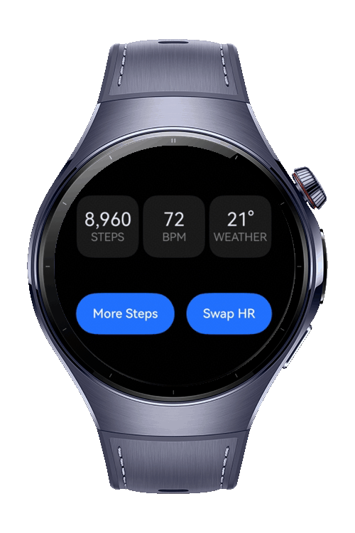

> **Note:** To access all shared projects, get information about environment setup, and view other guides, please visit [Explore-In-HMOS-Wearable Index](https://github.com/Explore-In-HMOS-Wearable/hmos-index).

# How To Build Custom Node Renderer

A wearable ArkTS Codelab compositor where each complication (steps, heart rate, weather) is an independent node built
with BuilderNode, NodeContent, NodeAdapter, NodeRenderType, and typeNode. Where typeNode can be repositioned, resized,or
swapped at runtime without rebuilding the UI.

# Preview

<div>
    
</div>

# Use Cases

- **Swappable complications**: re-render one tile via `reloadItem`, not the whole face.
- **Data-driven dials**: generate nodes lazily from a data array through `NodeAdapter`.
- **Per-node formatting**: each tile formats its own value (commas, degree symbol) at render time.
- **Off-screen rasterization**: switch `NodeRenderType` to texture mode for smoother redraws.
- **Hybrid UI**: splice an imperative node tree into declarative `build()` via `NodeContent`.

# Tech Stack

- **Languages**: ArkTS, ArkUI
- **Frameworks**: HarmonyOS SDK 6.0.1(21)
- **Tools**: DevEco Studio Version 6.1.1
- **Libraries & Kits**:
    - `@kit.AbilityKit`
    - `@kit.ArkUI`
    - `@kit.PerformanceAnalysisKit`

# Directory Structure

```
entry/src/main/ets/
|---pages
|   |---Index.ets
|---module.json5
```

# Constraints and Restrictions

## Supported Devices

- Huawei Watch 5
- DevEco Studio Emulator

# License

**How To Build Custom Node Renderer** is distributed under the terms of the MIT License
See the [license](./LICENSE) for more information.
